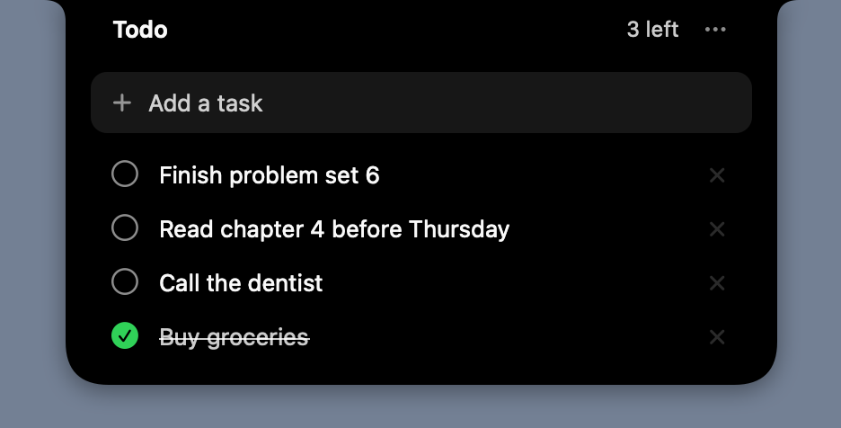
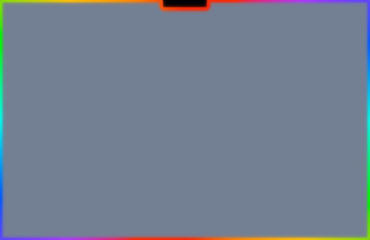

# NotchTodo

A tiny todo list that lives in your MacBook's notch. Hover the notch and it drops down; move away and it tucks back in.



With tasks left, a color ring moves around the closed notch:


Or, if you set it to, around the edges of the whole screen:



## Features

- Hover the notch to open it. Move the mouse away, press Esc, or click anywhere else to close it.
- Type a task and press Return to add it. Click a task to check it off; click × to delete it.
- Finished tasks sink to the bottom. Clear them from the ⋯ menu.
- While any task is unchecked, a moving color ring surrounds the notch so you can't forget about it. It disappears once everything is checked off.
- Pick the ring's colors (Rainbow, Sunset, Ocean, Aurora, Candy or your own three), speed, saturation and brightness in ⋯ → Settings….
- For something even harder to miss, set **Show around** to **The whole screen**: the colors run around every edge of the screen and still wrap the notch. Clicks pass straight through it.
- Set **Style** to **Flash at random times** and the colors stay hidden, then blink twice at a random moment every few seconds or minutes. You pick the range, for example every 20 to 60 seconds.
- You can pause the ring for 30 minutes at a time, but there's no off switch: a pause always ends on its own.
- Open at Login toggle in the ⋯ menu.
- Tasks are stored locally as JSON in `~/Library/Application Support/NotchTodo/todos.json`. No account, no network.
- On a Mac without a notch, the middle of the menu bar acts as the hover zone.

## Install

NotchTodo is free and isn't notarized by Apple (that needs a paid developer account). So if you download it in a browser, macOS blocks it the first time you open it. Installing from Terminal avoids that warning.

### Option 1: Terminal (no warning)

Paste this into Terminal. It downloads the latest release into Applications and opens it:

```bash
curl -fsSL https://github.com/aneeshkaravadi/notch-todo/releases/latest/download/NotchTodo.zip -o "$TMPDIR/NotchTodo.zip" && ditto -x -k "$TMPDIR/NotchTodo.zip" /Applications && open /Applications/NotchTodo.app
```

macOS only quarantines files downloaded by apps like Safari and Chrome, so this copy opens normally. Run the same command again later to update (quit NotchTodo first).

### Option 2: Download the zip

1. Download **NotchTodo.zip** from the [latest release](https://github.com/aneeshkaravadi/notch-todo/releases/latest).
2. Unzip it and drag **NotchTodo.app** into your Applications folder.
3. Open it. macOS says it can't verify the app. Close the warning without picking Move to Trash, then go to **System Settings → Privacy & Security**, scroll down to the message about NotchTodo, and click **Open Anyway**. You only need to do this once.

   Or clear the block from Terminal: `xattr -dr com.apple.quarantine /Applications/NotchTodo.app`

There's no Dock icon. Hover the notch to use it, and quit from ⋯ → Quit NotchTodo. Runs on macOS 14 or later, on Apple silicon and Intel Macs.

## Build from source

You need the Command Line Tools (`xcode-select --install`). Xcode is not needed: the app is a single Objective-C file built with `clang`.

```bash
git clone https://github.com/aneeshkaravadi/notch-todo.git
cd notch-todo
./build.sh install
```

`./build.sh` on its own builds `build/NotchTodo.app`. With `install` it also copies the app to `~/Applications` and launches it.

## Options

- `NOTCHTODO_FILE=/path/to/todos.json` stores tasks somewhere else.
- `--pin-open` keeps the panel open without hovering.
- `--snapshot out.png` opens the panel, saves a picture of it, and quits. Add `--closed` to picture the closed notch and its ring instead.
- `--snapshot-settings out.png` does the same for the Settings window.
- `--snapshot-screen out.png` pictures the whole-screen border (add `-RingWholeScreen YES` to try it without changing your setting).
- `--log-flashes` logs when each flash is scheduled and fires. Combine it with `-RingFlash YES -RingFlashMin 2 -RingFlashMax 3` to watch flash style without changing your settings.

## Credits

The approach for placing a window over the notch follows [TodoMenu](https://github.com/mitian233/TodoMenu) and [NotchDrop](https://github.com/Lakr233/NotchDrop).

## License

[MIT](LICENSE)
